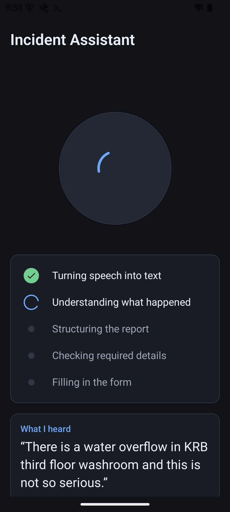
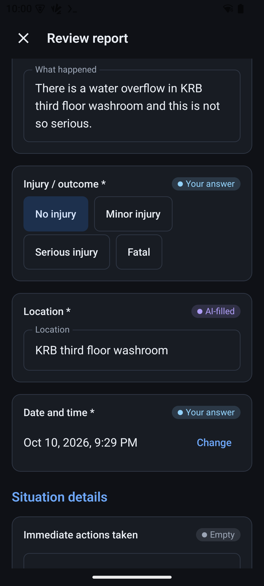
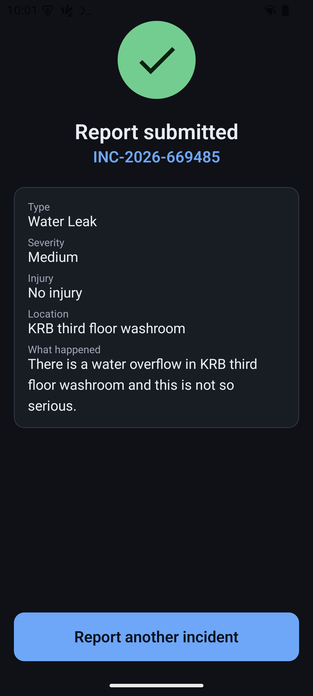
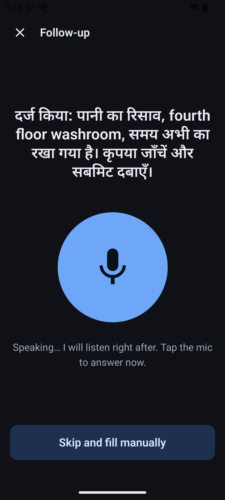
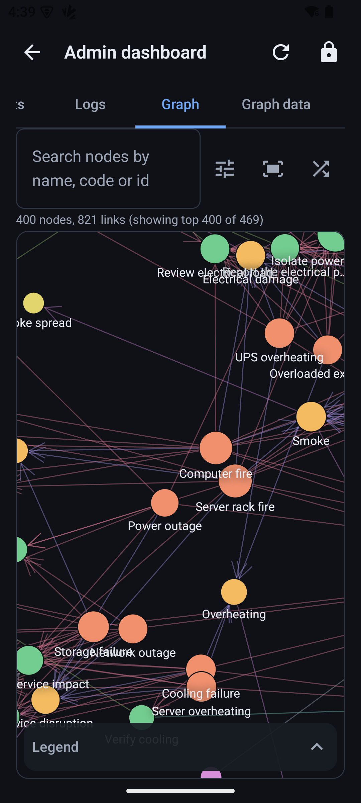
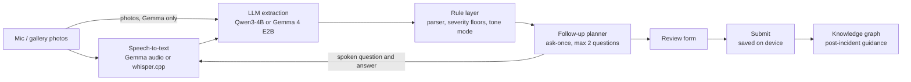

# AI Incident Report Assistant

**Winner, Megathon X (IIIT Hyderabad), Qualcomm track**

An Android app that turns a spoken (or photographed) incident into a structured, reviewable incident report,
running entirely on a Qualcomm QIDK (Snapdragon 8 Elite, Hexagon NPU). There is no cloud API and no
`INTERNET` permission: the app works in airplane mode.

The design principle is **the model proposes, the code verifies**: the on-device LLM only turns language into
fields, while severity, which follow-up question to ask, when to stop, and what is said about emergencies are
decided by deterministic, unit-tested Kotlin.

<p>
  
  
  
  
  
</p>

## Features

- **Voice reporting**: speak naturally; the app transcribes, extracts the report fields and fills an editable review form.
- **Photo input**: attach up to 3 gallery photos (downscaled to 512 px); with the Gemma backend each photo is
  described and used in extraction. A photo-only mode files a report without speaking.
- **Short, deterministic follow-ups**: asks only about fields that are still missing, each at most once, at most
  2 questions per report; tone modes PLAIN / CARE / URGENT with a negation guard ("no one was hurt").
- **Rule-based severity**: final severity = max(model hint, rule floors); fire, gas and electrical hazards are at
  least High. URGENT reports show an emergency banner and ask one safety question (nothing is sent automatically).
- **Multilingual**: with Gemma, speech in Indian languages is transcribed on the device and the report is written in
  English. Questions and read-backs are spoken in Hindi and Telugu (translations pending native review);
  offline speech output via sherpa-onnx (Piper for English, AI4Bharat Rasa for Indic scripts).
- **Post-incident guidance**: after submission, an offline knowledge graph (458 nodes, 872 edges, 56 incident types)
  suggests ranked next steps, with safety and medical filters, and abstains when evidence is weak.
  The shipped guidance is demo content, not real SOPs.
- **Admin dashboard**: PIN-gated (demo gate, not real security) with report history, logs, statistics, an interactive
  graph view and a versioned knowledge editor.
- **Built-in evaluation**: a developer-menu eval run (WER, field match, dialogue invariants, latency) and a Mock AI mode
  for demos without model files.

## Architecture



## Models and runtimes

Two switchable on-device backends, selected in the hidden developer menu (long-press the Home title).
The app starts in Mock AI mode; with Real AI on, the default backend is Qwen3-4B + Whisper.

| Role | Backend 1: Qwen3-4B + Whisper | Backend 2: Gemma 4 E2B |
|---|---|---|
| Speech-to-text | whisper.cpp `small.en` (CPU, English) | Gemma native audio input |
| Extraction LLM | Qwen3-4B-Instruct-2507 (w4a16) via QAIRT/Genie, Hexagon NPU | Gemma 4 E2B (q4_0) via llama.cpp (JNI): LLM on the NPU, audio/image encoder on the Adreno GPU |
| Photos | attached only | described by Gemma |
| Speech output | sherpa-onnx: Piper (English) + AI4Bharat Rasa (Indic), Android TTS fallback | same |

Models are not included in the repository; see the setup guide.

## Repository structure

```
.
├── android/     Android app (Gradle project): app/, doc/, eval/, tools/
├── research/    Rule-layer prototype, severity framework, multilingual benchmark
├── docs/        Setup guide and screenshots
├── LICENSE
└── README.md
```

## Quick start

```sh
cd android
./gradlew assembleDebug testDebugUnitTest      # gradlew.bat on Windows; unit tests need no device
```

Running on a QIDK (runtime libraries, model files, on-device tests): **[docs/SETUP.md](docs/SETUP.md)**.

## Evaluation highlights

| Measurement | Result | Source |
|---|---|---|
| LLM selection, 35-case dev set (4 fields per case) | Qwen3-4B: 93.6% field accuracy, 100% valid JSON, 1 hallucinated field. Llama 3.2 1B: 47.9%, 68.6% valid JSON, 8 hallucinated fields | `research/rules_and_evaluation/results/` |
| Rule layer on the same set | Qwen3-4B + rules: 100%, 0 hallucinated fields (dev-set figure, optimistic: the rules were written against this set) | `research/rules_and_evaluation/results/` |
| Whisper on the QIDK CPU (4 clips) | `small.en`, 6 threads: 0.0% WER, 3,052 ms median; `base.en`: 11.1% WER, 1,021 ms (approximate references) | `android/doc/MODEL_INTEGRATION.md` |
| Qwen3-4B extraction on the NPU (24 runs) | prefill median 758 ms, decode median 6,859 ms; model load 3.1-3.7 s | `android/doc/PROMPTS.md` |
| End-to-end audio run (Qwen + Whisper, 4 recordings) | end of speech to filled form: 12,313 ms median; WER 0.0%; field accuracy 6/9 | `android/doc/EVAL_RESULTS.md` |
| Photo-only reports (Gemma, 6 photos) | 6/6 runs ok, 11/12 fields correct, 0 questions asked, every severity floor met | `android/doc/TESTING.md` |
| Multilingual speech (Gemma) | language identified correctly for Assamese, Odia and Telugu; Tamil needed the language set manually | `android/doc/TESTING.md` |
| Tests | 900+ JVM unit tests and 26 on-device tests | `android/app/src/test`, `android/app/src/androidTest` |

## License

MIT, see [LICENSE](LICENSE).
