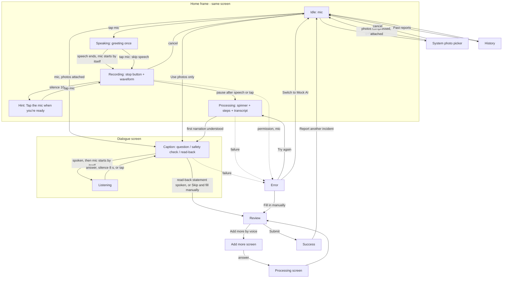
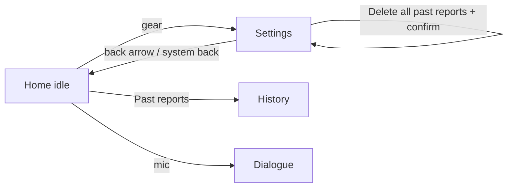
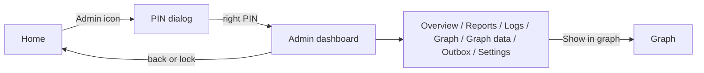

# UI flow

Navigation is state-driven: `ui/AppRoot.kt` maps `FlowState` to a screen (`Screen` enum) and cross-fades between
them (instant under "reduce motion"). Back button = `Cancel` (Review ignores it; use the X with a confirm dialog;
Success -> Home; History -> Home).

**Voice path = Home frame, then the dialogue screen.** `Idle` and the first pass of the follow-up dialogue (greeting,
listening for the narration, first extraction; `DialogueView.firstPass`) render the same `HomeScreen`
(`HomeMode.IDLE / SPEAKING / RECORDING / PROCESSING`), so the mic button turns into a stop button and then a spinner in
place, with no screen change (ADR-016). Once the first narration is understood the `DialogueScreen` takes over for the
ask-once follow-up questions and the read-back. The state diagram with all flow and dialogue states is in
`STATE_MACHINE.md`; this is the screen view of the same flow:

## Screens

### Home frame (`ui/home/HomeScreen.kt`, `HomeMode`)
Title at the top (long-press opens the developer menu). The big 176 dp mic sits at a fixed offset
(`AppSizes.homeMicTopGap`) so it does not move between modes. Under the title: **"Loading models..."** (spinner) while the
real model loads at app start (the mic stays usable; processing waits for the model), or a red "Model not loaded" line when
loading failed. Banner for TTS notices.
- **IDLE**: `MicButton` (primary, mandatory), "Tap and describe what happened.", then at the bottom the smaller
  GALLERY button (photo-library icon, label "Gallery", content description "Add photos from the gallery", 64 dp) and a quiet "Past reports (N)" button. With a caption (the 10 s hint "Tap the mic when you're
  ready.") the shortcuts are hidden, a "Cancel" link shows, and the mic starts the listening again.
- **SPEAKING** (only with `DialogueConfig.speakGreeting`, off by default since ADR-052; the first mic tap starts recording at once and nothing is spoken first): the dialogue speaks the greeting "Hi, describe your incident." once (shown as the caption). The mic is
  idle; tapping it skips the speech and listens now. "Cancel".
- **RECORDING** (`MicSpeechIn` over `AudioRecorder`): the same button becomes the red stop button (pulsing ring follows the
  level); below it the elapsed timer, live `Waveform`, hint, "Cancel". Recording stops by itself 2 s after speech ends;
  8 s (10 s for the narration) without speech = "no response" (the narration then shows the hint instead).
- **PROCESSING**: the button becomes a spinner (`ProgressOrb`); below it `ProcessingSteps`: five rows (speech to text,
  understanding, structuring, checking required details, filling the form: done / active / pending) and the
  "What I heard" card as soon as the transcript is ready. "Cancel".
Exits: gallery -> system photo picker (no permission) -> back on the same Home frame with the photos attached; history; dev sheet (`DevMenuSheet`); first pass ends in the Dialogue screen
or (after the read-back) Review.

### History (`ui/home/HistoryScreen.kt`)
Read-only list of submitted reports (ID, time, type, location). Entry: Home. Exit: back.

### Gallery photos (ADR-053; replaces the camera screen)
The Home gallery button opens the Android system photo picker (`PickMultipleVisualMedia`, images only, at most 3; on devices without the photo picker `GetMultipleContents("image/*")`, which cannot limit the count, so extra photos are dropped with a banner). No storage or camera permission is needed or declared. Cancel changes nothing; a picker that cannot start or a photo that cannot be read gives a banner message (no crash). Every picked photo is compressed at once (`media/ImageCompressor`: decoded with `inSampleSize`, EXIF orientation applied, long side <= 512 px, JPEG quality 80, stored as `files/media/<uuid>.jpg`; the original is never copied) while Home shows "Preparing photos..." and the mic waits. Photos make speaking OPTIONAL (ADR-062): the primary button "Use photos only" sits directly under the thumbnails and sends them as they are (no greeting, no question, no microphone; Review then shows what the photos support, low confidence, the rest flagged); the big mic below it ("Or tap and describe what happened.") adds a spoken description and starts the normal flow (photos + narration, at most 2 questions). Then the same Idle Home frame shows the attached photos as small `Thumbnail`s above the mic with "Photos attached. Tap the mic and describe what happened.", a "Remove photos" link and, only when a model can describe photos (Gemma, or Mock AI), a "Continue with photos only" button. The mic starts the voice dialogue as usual (`StartVoiceWithPhotos`); the thumbnails stay above the mic through the first pass. "Continue with photos only" (`StartPhotoOnly`) starts the dialogue with an empty narration: the photos are described, the report is extracted from the descriptions (AI fields at confidence <= 0.5, so Review shows them as low confidence) and the dialogue asks its usual questions (cap 2). With the Qwen backend (no vision model) the photos are only attached to the report; that is stated in Settings > About ("Photos: Attached only"), not as an error, and "Continue with photos only" is not offered.

### Dialogue (`ui/dialogue/DialogueScreen.kt`)
Shown from the first follow-up on. The caption is the line the assistant just said: a question, the URGENT safety check,
or the read-back statement (it asks nothing; the mic does not start after it). Title "Question i of cap" (at most 2 questions per report in total in every mode, the URGENT safety check included; ADR-048). **Hands-free**: after the line is spoken (plus 300 ms)
the microphone starts by itself; the big button is the red stop button with timer and waveform ("Listening. Just answer; I
stop when you pause."). Tapping the mic while the line is read skips the speech. While speaking: "Speaking... I will listen
right after." While the answer is processed: a spinner. **There is no retry, no "read aloud again", no re-ask**: every field
is asked once; silence is recorded as `no_response`. URGENT mode shows the red `EmergencyBanner` (no alert is sent).
"Skip and fill manually" (tonal button) goes to the form with what is known. Entry: first narration understood. Exit: read-back
answered or not (no repeat) -> Review.

### Processing screen (`ui/processing/ProcessingScreen.kt`)
Used for the "Add more by voice" pass and the form-filling step: `ProcessingSteps` in a full screen. X cancels.

### Add more (`ui/clarification/ClarificationScreen.kt`)
"What would you like to add?" (shown, not spoken); recording starts immediately and stops on a 2 s pause after speech or on
tap (`IncidentFlowViewModel`: `SPEECH_LEVEL`, `SILENCE_LEVEL`, `SILENCE_STOP_MS`). "Skip and fill manually" returns to the form.
Entry: Review "Add more by voice". Exit: answer -> Processing screen -> Review.

### Review (`ui/review/ReviewScreen.kt`, `FieldEditors.kt`)
Header with report ID and a status sentence; **red `EmergencyBanner` when `dialogue.emergency`**; photo thumbnails; collapsible
"What you said" (transcript + Q&A); fields in four groups (Required details, Situation details, Optional details, Filled by
the app). Each field card: label (`*` = mandatory), `SourceChip` (AI-filled / Your answer / Edited / Empty), editor by kind
(text, chips for severity/injury/yes-no, date+time pickers, comma list, witness lines). Red border + "Required" for missing,
amber border for low confidence **and for dialogue statuses `unknown_reporter_unsure` / `no_response` / `unverified` /
`missing_flagged`** (caption explains; an edit clears it). Reporter card with Anonymous switch and GPS status.
Buttons: "Add more by voice" (secondary), "Submit report" (primary; disabled with "Fill required details to submit"
while a required field is missing). X asks "Discard this report?". Submitting speaks the dialogue's closing line once.

### Success (`ui/success/SuccessScreen.kt`)
Check mark, "Report submitted", report ID, summary (type, severity, injury, location, what happened),
"Report another incident".

### Error (`ui/error/ErrorScreen.kt`)
Friendly title and message per `FlowError`. Buttons: "Try again" (or "Allow access" for permissions, plus
"Open app settings"; after a model failure it retries the model load), **"Switch to Mock AI"** (Real AI mode, model or
extraction failures), "Fill in manually" when a report exists, "Cancel"/"Discard report".

### Developer menu (`ui/home/DevMenuSheet.kt`)
Hidden bottom sheet. **Mock AI / Real AI switch** (persisted) and the LLM-rephrase switch; the typed-transcript box (mock
STT stand-in, Whisper is not available yet); scenario radio list; delay sliders (0-5000 ms). See `SERVICES_AND_MOCKS.md`.

## Accessibility and motion
Min touch target `AppTheme.sizes.minTouch` (48 dp); content descriptions on all icon-only controls; text uses `sp`
tokens so system font scaling works; pulse/crossfade disabled when the system animator scale is 0.

## Severe incidents: call for help
When `severity_level` is High or Critical (suggested by the app or set by the user), the Success screen shows a red-bordered
"Severe incident: call for help" card below the summary, listing 5 dummy contacts (`EmergencyContacts.DUMMY`). Tapping a row
opens the phone dialer with that number. (Not on Review.) This is separate from the dialogue's URGENT emergency flag, which
only shows the banner: nothing is dialled or sent automatically.

## Spoken read-outs (after the dialogue)
- **Review**: when the form is filled the app reads ONE short line aloud (`FormReadout.review`: type, place, time, severity, injury if known, up to 3 missing/flagged fields, a pointer to the emergency contacts for High/Critical; never "notified" / "help is on the way"). Once per Review entry, not after edits or when coming back from a submit error. The **speaker button** next to the report ID ("Read aloud" / "Stop reading aloud") replays the current form or stops the speech. Speech stops on edit, submit, leaving the screen and before any recording starts (mic and TTS never overlap).
- **Success**: "Report submitted. Reference I N C, 2026, 6 6 5 9 4 8." plus "You can call the emergency contacts on screen." when severe.
- Developer menu "Read results aloud" (default on) disables the automatic read-outs. See ADR-043 and `DIALOGUE.md`.

## Settings screen (user-facing; the hidden developer menu stays)
A gear icon (`Icons.Filled.Settings`, 48 dp, content description "Settings", `mutedText` tint) sits in the top-right of the Home title row. It is shown only on the idle Home: hidden while the assistant is speaking, listening, processing, or in any other flow state, so it never interrupts a recording. It opens `ui/settings/SettingsScreen` (the same route mechanism as Past reports: a `rememberSaveable` flag under `Idle`; back arrow top-left and the system back both return Home).

Sections (cards, tokens only): **Conversation**: Follow-up questions (switch, default on, one-line explanation; off = nothing is asked), Hands-free answers (switch, default on, dimmed and inert while follow-ups are off; off = tap the mic to answer, no tap within 10 s = skipped). **Voice**: Read results aloud (switch, default on; the single source of truth, no longer in the developer menu), Speech rate (chips Slow 0.8 / Normal 1.0 / Fast 1.25). **Emergency contacts**: the 5 contacts, read-only list with the same dial action (`EmergencyContactsCard(severe = false)`). **Past reports**: count and "Delete all past reports" (disabled with no reports; confirm dialog "Delete all" / "Keep them"). **About**: app version, report schema, AI backend, models state (Mock AI "Not needed", or Loading / Loaded / Failed), "Everything runs on this device".
With "Hands-free answers" off the Dialogue screen shows an idle mic and "Tap the mic, then answer. If you don't, this question is skipped.".

## Spoken language (ADR-054)
Settings > Voice > "Spoken language" shows the current value ("Auto-detect" or a language name) and opens the same bottom sheet (`SpokenLanguageSheet`: radio list "Auto-detect" plus the names of `assets/dialogue/languages.json`) as the Home chip. The chip (`LanguageChip`, "Language: Auto" / "Language: Tamil", 48 dp, tappable) sits under the mic text on the idle Home (not while a caption, recording or processing is shown). Both are only active with the Gemma speech model; with Whisper the Settings row is dimmed and inert with the note "Whisper small.en listens in English only" (the mock: "Only the Gemma speech model uses this setting") and the chip is hidden. The choice is persisted and applies to every transcription.

## Post-incident analysis card (ADR-055)
On the Success screen, under the summary (and the emergency contacts for severe incidents), `AnalysisCard` shows the offline knowledge-graph output: a collapsible card "Post-incident analysis" (collapsed by default: one summary line, the "Demo guidance - pending IIIT-H admin approval" label in the warning colour, expand/collapse chevron, 48 dp header). Expanded: "Do now" (immediate actions), "What could follow" (consequences tagged POSSIBLE / LIKELY / CONFIRMED), "Next steps", "Recovery", "Temporary arrangements", "Prevent it happening again", "Responsible roles" (labels only; contacts only when an admin verified them), at most one "One thing would help" question, and the medical footer for injury cases. States: running (spinner), done, abstained ("Not enough information..."), failed ("The analysis is not available right now. Your report was submitted."). It runs off the main thread after the submit succeeded and never changes the submission. Settings > "After a report" > "Post-incident analysis" switches it off (default on).

## Admin dashboard (ADR-058)
Home (idle) top bar: title, **Admin** icon (`AdminPanelSettings`, content description "Admin dashboard"), Settings gear. Admin opens the PIN dialog (4 digits, default 0000, demo gate) and then `AdminDashboardScreen`: top bar (back = lock and leave, reload, lock), a scrollable tab row (Overview, Reports, Logs, Graph, Graph data, Outbox, Settings), a notice banner, then the tab. The system back button locks and leaves. Details of each tab, the graph gestures and the highlighting: `doc/ADMIN_DASHBOARD.md`.

