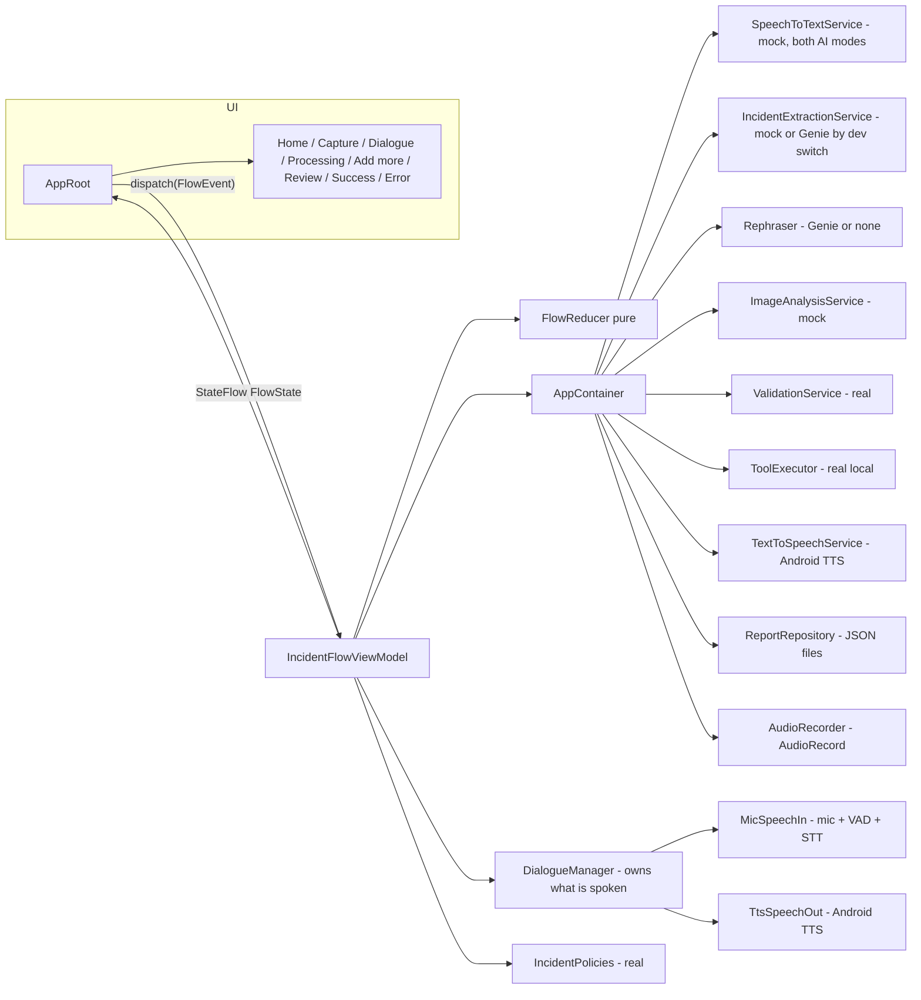

# Architecture

Single-module Android app, package `com.example.test_app`. MVVM + one explicit state machine.
No network code anywhere (no INTERNET permission).

## Layers

| Layer | Package | Role |
|---|---|---|
| UI | `ui/**` | Stateless Compose screens + components. Read state, call callbacks. No business logic. |
| Flow | `flow/` | `FlowState`/`FlowEvent`/`FlowReducer` (pure state machine) and `IncidentFlowViewModel` (runs side effects per state). |
| Domain | `domain/` | Data classes (Incident JSON), config, service **interfaces**, real logic (validation, policies, JSON codec). Pure Kotlin. |
| Mocks | `mock/` | Mock implementations of AI services and `DevSettings` (scenarios, delays). |
| Platform | `platform/` | Real Android implementations: `AudioRecorder`, `AndroidTextToSpeechService`, `JsonFileReportRepository`, `LocalToolExecutor`, `DeviceContext`. |
| DI | `AppContainer.kt` | The ONE place that picks implementations. Manual DI (see ADR-004). |



## How a turn works

1. UI calls `vm.dispatch(event)`.
2. `FlowReducer.reduce(state, event)` returns the next state (pure; unit-tested).
3. The ViewModel publishes the state and runs the effect for the state it just entered
   (`IncidentFlowViewModel.enter`): transcribe, extract, validate, speak, fill form, submit.
4. The effect finishes by dispatching the next event (`TranscriptReady`, `ExtractionReady`, ...).
   Dispatching is always the last statement of an effect (dispatch cancels the current effect job).

## Per-pass pipeline in the ViewModel

Voice path (with optional gallery photos, ADR-053): `Dialogue` (`DialogueManager`: greeting, listen, extract, classify, ask-once follow-ups, read-back; see `DIALOGUE.md`) ->
the ViewModel adds device info, `IncidentPolicies` and `ValidationService` -> `DialogueFinished`. "Add more by voice": `Transcribing` -> `Extracting` ->
`Validating` -> `FillingForm`.

## Folder structure

See `FILE_MAP.md` for every file. Top level:

```
app/src/main/java/com/example/test_app/
  AppContainer.kt  MainActivity.kt (also IncidentApp)
  domain/{model,config,service}
  flow/
  mock/
  platform/
  ui/{theme,components,home,capture,processing,clarification,review,success,error}
app/src/test/...   unit tests (reducer, validation, policies, scenarios)
doc/               handover docs
```

## Threading

All state lives on the main thread (`viewModelScope`). `AudioRecorder` writes on `Dispatchers.IO`.
Repository IO uses `Dispatchers.IO`. Services are `suspend` so real models can run on any dispatcher.

## Offline guarantee

No `INTERNET` permission in `AndroidManifest.xml`. TTS uses the on-device engine. Photos and reports live in
app-private storage (`filesDir/media`, `filesDir/reports`); recorded audio in `cacheDir` and deleted after STT.
