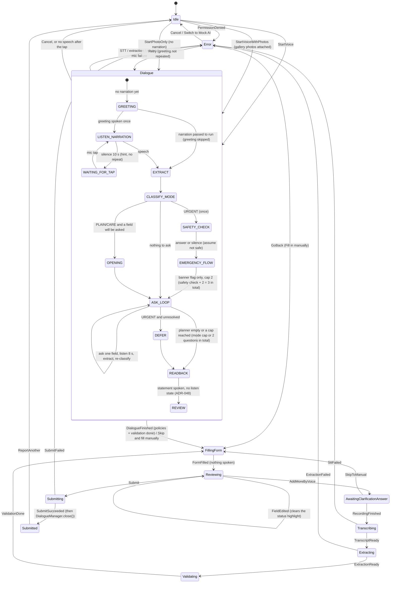

# State machine

Code: `flow/FlowState.kt` (`FlowState`, `FlowEvent`, `FlowReducer`, `Session`, `FlowError`) and
`flow/IncidentFlowViewModel.kt` (side effects); the dialogue's own states are `dialogue/DialogueManager.kt`
(`DialogueState`). Tests: `FlowReducerTest`, `DialogueScenarioTest`.
`FlowReducer.reduce(state, event)` is pure. An (state, event) pair not listed below returns the state unchanged.

The flow has ONE state for the whole follow-up conversation, `Dialogue`; inside it `DialogueManager` runs the states of
spec v2 section 5 (greeting, listening, extraction, mode classification, safety check, ask loop, read-back). The reducer
does not see them: the ViewModel publishes them as `DialogueView` for the UI.

## Flow states

| State | Meaning | Side effect on entry (ViewModel `enter`) |
|---|---|---|
| `Idle` | Home. Gallery photos picked here are held by the view model (`photos`), not by the state. | Stop TTS, clear photos/transcript/dialogue, refresh history. |
| `Dialogue(session)` | The follow-up dialogue owns the turn (voice path, with gallery photos attached or photo only). | `runDialogue`: build `DialogueManager` (`MicSpeechIn`, `TtsSpeechOut`, extraction + rephraser for the chosen AI mode, tool executor, JSONL logger); photo only (`Session.mode = PHOTO_ONLY`): pass an empty narration so the dialogue goes straight to the photo descriptions; `manager.run(...)`; on `Review` -> add device info, `IncidentPolicies`, validation, dispatch `DialogueFinished`; errors -> `ExtractionFailed(model)` / `SttFailed` / `RecordingFailed`; silence -> notice + `Cancel`. |
| `Transcribing(session)` | STT running ("Add more by voice" pass only). | `SpeechToTextService.transcribe`; delete the audio; dispatch `TranscriptReady` / `SttFailed`. |
| `Extracting(session)` | Extraction running (add-more pass only). | `IncidentExtractionService.extract(ExtractionRequest)` with the previous report, the answer, and the add-more question (empty target list); JSON-decode; dispatch `ExtractionReady` / `ExtractionFailed`. |
| `Validating(session)` | Validation (add-more pass only). | Device info, `IncidentPolicies.apply`, `ValidationService.validate`; dispatch `ValidationDone`. |
| `AwaitingClarificationAnswer(session, question)` | Listening for the "add more" voice input. | Stop TTS and **start the recorder automatically**; the ticker stops it after 2 s of silence following speech. |
| `FillingForm(report, manual)` | Tool call `fill_incident_form`. | `ToolExecutor.fillIncidentForm`; dispatch `FormFilled`. **Nothing is spoken** (the dialogue's read-back already was). |
| `Reviewing(report)` | Review form. | none |
| `Submitting(report)` | Tool call `submit_incident_report`. | `ToolExecutor.submitIncidentReport` (saves locally); `DialogueManager.close()` speaks the closing line once (not awaited); dispatch `SubmitSucceeded` / `SubmitFailed`. |
| `Submitted(report)` | Success screen. | none |
| `Error(kind, detail, retryState, backState)` | Friendly error. | none |

`FlowError`: `MIC_PERMISSION_DENIED`, `MODEL_FAILURE` (on-device model could not load; the
screen offers "Switch to Mock AI"), `RECORDING_TOO_SHORT`, `RECORDING_FAILED`, `STT_FAILURE`, `EXTRACTION_FAILURE`,
`SUBMIT_FAILURE`. TTS unavailability is not a state: it is a banner (`notice`), see ADR-012.

`Session` carries: `mode`, `audio` (add-more recording), `media`, `transcript`, `pendingAnswer`,
`report`, `question` (add-more only) and `greeted` (a retry after an error must not greet again).

## Transitions

| From | Event | To | Notes |
|---|---|---|---|
| Idle, Error | `StartVoice` | Dialogue(Session(VOICE)) | UI has already ensured RECORD_AUDIO. |
| Idle, Error | `StartVoiceWithPhotos(media)` | Dialogue(Session(VOICE_AND_PHOTO, media = photos)) | Mic tapped with gallery photos attached; no photos = plain `VOICE`. |
| Idle, Error | `StartPhotoOnly(media)` | Dialogue(Session(PHOTO_ONLY, media = photos)) | "Use photos only" (ADR-062); no question, no microphone, no greeting in this session; no photos = plain `VOICE`. |
| Idle, Error, Dialogue | `PermissionDenied` | Error(MIC_PERMISSION_DENIED) | |
| any except Submitting/Submitted | `Cancel` | Idle | VM discards audio + photos (never submitted reports). |
| Dialogue | `DialogueFinished(report)` | FillingForm(report, manual = !is_complete) | Report already has policies + validation. Also used by "Skip and fill manually" (`skipDialogue()`: current report, or `Cancel` if nothing was extracted yet). |
| Dialogue | `SttFailed` | Error(STT_FAILURE), retry -> Dialogue(session with `greeted = true`) | Mic transcription failed. |
| Dialogue | `ExtractionFailed(model = false)` | Error(EXTRACTION_FAILURE), retry as above | First extraction only; later ones just mark the field. |
| Dialogue | `ExtractionFailed(model = true)` | Error(MODEL_FAILURE), retry as above | `ModelLoadException`. |
| Dialogue | `RecordingFailed` | Error(RECORDING_FAILED), retry as above | Microphone could not be opened. |
| AwaitingClarificationAnswer | `RecordingFinished` | Transcribing(session + audio + question) | |
| AwaitingClarificationAnswer | `RecordingTooShort` / `RecordingFailed` / `PermissionDenied` | Error, retry -> Awaiting, back -> manual form | |
| AwaitingClarificationAnswer | `SkipToManual` | FillingForm(manual) | "Skip and fill manually". |
| Transcribing | `TranscriptReady` | Extracting | |
| Transcribing | `SttFailed` | Error(STT_FAILURE), retry -> Transcribing (same audio), back -> manual form | |
| Extracting | `ExtractionReady` | Validating | |
| Extracting | `ExtractionFailed` | Error(EXTRACTION_FAILURE or MODEL_FAILURE), back -> manual form | |
| Validating | `ValidationDone` | FillingForm(manual = !is_complete) | No clarification question any more. |
| FillingForm | `FormFilled` | Reviewing | |
| Reviewing | `FieldEdited` | Reviewing | VM applies `IncidentPolicies` + revalidates first; the edited field loses its dialogue status. |
| Reviewing | `AddMoreByVoice` | AwaitingClarificationAnswer(add-more question) | Current report is the context. |
| Reviewing | `Submit` | Submitting | Only if `missing_fields` is empty. |
| Submitting | `SubmitSucceeded` | Submitted | |
| Submitting | `SubmitFailed` | Error(SUBMIT_FAILURE), retry -> Submitting, back -> Reviewing | |
| Error | `Retry` | `retryState` or Idle | |
| Error | `GoBack` | `backState` | "Fill in manually". |
| Submitted | `ReportAnother` | Idle | |

## Dialogue states (inside `Dialogue`)

`DialogueState`: `GREETING` (ADR-052: never entered unless `DialogueConfig.speakGreeting` is on; the default dialogue starts in `LISTEN_NARRATION` with no TTS before it; skipped when a narration is passed in) -> `LISTEN_NARRATION` (10 s silence ->
`WAITING_FOR_TAP`: hint, no repeat, until `onMicTap`) -> `EXTRACT` -> `CLASSIFY_MODE` (escalate-only) -> URGENT:
`SAFETY_CHECK` (once; silence = not safe) -> `EMERGENCY_FLOW` (banner flag only) -> `OPENING` (only if something will be
asked; not in URGENT) -> `ASK_LOOP` (per field: rephrase-or-template, speak, listen 8 s, extract, re-classify; per-mode cap 2/3/2 AND a strict total of 3 questions per report incl. the safety check) ->
`DEFER` (URGENT with unresolved fields) -> `READBACK` (once; a STATEMENT: nothing is asked and nothing is listened for, ADR-048) -> `REVIEW`.
Details, outcomes and statuses: `DIALOGUE.md`.

## Merged diagram

## Processing sub-phase (UI only)

`ProcessingPhase` (`STT, LLM, JSON, VALIDATION, FORM`) is a separate `StateFlow` in the ViewModel; it only drives
the step list on the Home PROCESSING mode and the Processing screen. In the dialogue it follows `MicPhase.TRANSCRIBING`
(STT) and `DialogueState.EXTRACT` (LLM). It is not part of the state machine.

## Read-outs (TTS after the form)
Not states: `IncidentFlowViewModel.dispatch` asks `flow/ReadoutPolicy.textFor(event, newState)` after every transition. `FormFilled` -> `Reviewing` speaks `FormReadout.review`; `SubmitSucceeded` -> `Submitted` speaks `FormReadout.submitted`; every other event (including `FieldEdited`, which re-enters `Reviewing`, and `GoBack` from a submit error) speaks nothing, so the line is spoken once per Review entry. `enter()` stops the TTS for every state except `Reviewing` and `Submitted`; `editField` and `startRecorder` stop it too. `readoutSpeaking` drives the speaker button.

## Settings (not a flow state)
Settings is a Home sub-route like Past reports (`AppRoot` flag under `Idle`), not a `FlowState`: the gear is only offered in `Idle`, so no recording, processing or dialogue is ever interrupted. User preferences (`UserSettings`) are read when a dialogue starts: `followUpsEnabled` and `handsFreeAnswers` go into `DialogueConfig`; `readResultsAloud` is checked by the read-out; `speechRate` is pushed to the TTS immediately. New dialogue state `WAITING_FOR_ANSWER_TAP` (only with "Hands-free answers" off): after a question has been spoken the dialogue waits up to 10 s for a mic tap before listening (`ASK_LOOP -> WAITING_FOR_ANSWER_TAP -> ASK_LOOP`); no tap = `no_response`. With follow-ups off the dialogue goes `EXTRACT -> CLASSIFY_MODE -> READBACK -> REVIEW` with no `SAFETY_CHECK`, `OPENING` or `ASK_LOOP`.

## Gallery photos (ADR-053)
The camera states are gone (`RecordingVoiceAndCamera`, `StartVoiceAndCamera`, `FlowError.CAMERA_PERMISSION_DENIED`, `PermissionDenied(camera)`; `RecordingFinished` no longer carries media). Picking photos is not a flow state: on the idle Home the system picker returns content URIs, the view model compresses them (`ImageCompressor`) and keeps the compressed `MediaItem`s in `photos` (max 3). `InputMode` is `VOICE`, `VOICE_AND_PHOTO` (`voice_and_photo`) or `PHOTO_ONLY` (`photo_only`); stored reports with the retired `voice_and_camera` read as `VOICE_AND_PHOTO`. Cancel (or leaving Idle by Cancel) deletes the compressed files of an abandoned session; "Remove photos" deletes them on Home.
